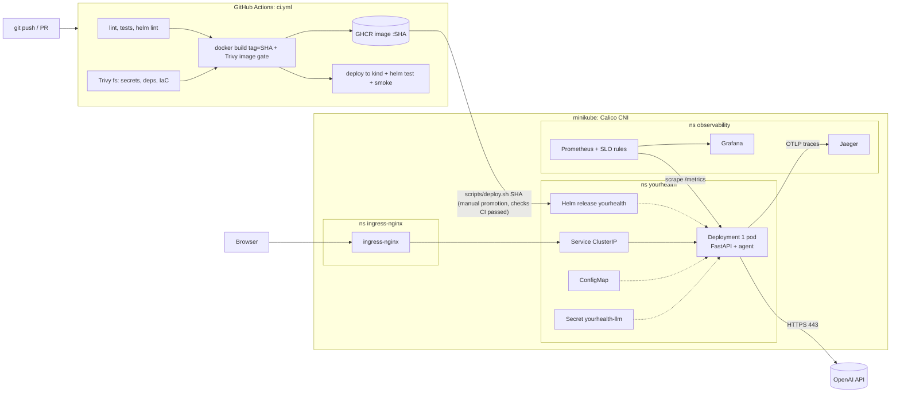

# YourHealth on Kubernetes: build, deploy, observe, explain

Baseline: [`bc50eb8`](BASELINE.md) (tag `baseline`). Everything below was added in one PR on top of it.
Evidence from real runs: [docs/EVIDENCE.md](EVIDENCE.md).

## 1. Architecture



**Request path.** Browser -> ingress-nginx (host `yourhealth.local`, cookie affinity, SSE buffering
off, 90s read timeout) -> pod IP:8000 -> FastAPI -> `Agent.respond` -> OpenAI chat completions (1-4
calls per turn) + tools reading/writing the in-process `Clinic` -> output guard -> reply (JSON or SSE).

**Components and dependencies**

| Component | Depends on | If it fails |
|---|---|---|
| ingress-nginx | Service endpoints | No external access; app still healthy (probes, metrics unaffected) |
| App pod | ConfigMap, Secret, image, OpenAI | Probe fails -> restarted / not routed; rollout blocked by `--atomic` |
| OpenAI API (external) | internet egress 443 | Agent hands off to staff (`llm_error`), HTTP stays 200; pod stays Ready on purpose; `YourHealthConversationFailures` alert |
| Prometheus | pod discovery RBAC | Lose metrics/alerts, app unaffected |
| Jaeger | - | Spans dropped by the batch exporter, app unaffected |

**Failure boundaries.** The app never depends on the observability stack (OTLP export is async and
best-effort; scrapes are pull). Readiness covers what a restart or reroute can fix (config loads,
clinic data present); the LLM is outside it on purpose (see 3.2).

**Linux / networking ideas applied.** Non-root UID 10001, read-only root FS with a size-limited
`emptyDir` on `/tmp`, all capabilities dropped, seccomp `RuntimeDefault`; SIGTERM + 70s grace so an
in-flight 60s turn can finish; default-deny NetworkPolicy with egress limited to DNS, 443 to
non-RFC1918 addresses (the internet, not the cluster) and OTLP to Jaeger.

## 2. What was added (vs baseline)

| Area | Added |
|---|---|
| App | `/readyz`, `/version`, `/metrics` (RED by route template, LLM calls/latency by result, turn outcomes, sessions, build info), OpenTelemetry tracing (FastAPI + LLM spans), `trace_id` in JSON logs, 3 tests |
| Image | Multi-stage Dockerfile, runtime has no uv/build tools, fixed UID, OCI labels with SHA, runs with read-only root |
| Kubernetes | Helm chart `deploy/helm/yourhealth`: Deployment, Service, Ingress, ConfigMap, ServiceAccount, NetworkPolicy, optional PDB, `helm test` |
| Config | `values.yaml` + `values-dev.yaml` / `values-prod.yaml` / `values-ci.yaml` (only the differences) |
| CI/CD | `ci.yml`: checks -> Trivy fs -> build (tag = SHA) -> Trivy image gate -> push GHCR -> kind deploy + helm test + smoke |
| Release | `scripts/deploy.sh` (manual promotion, refuses SHAs without green CI, `--atomic`), `helm rollback` |
| Observability | `deploy/observability`: Prometheus (pod SD, recording rules, SLO burn alerts), Grafana dashboard, Jaeger |
| Security | Secret out of band, no SA token, NetworkPolicy, pod/container security context, Trivy gates, GHCR push with the workflow token |
| Docs | `BASELINE.md`, this file, `docs/EVIDENCE.md` |

## 3. Decisions and tradeoffs

### 3.1 Workload: one-replica Deployment, not StatefulSet, no PVC
Sessions (`InMemorySessionStore`) and the clinic's bookings live in process memory, and one `Clinic`
object is shared so two patients really compete for one slot. Two replicas would be two clinics
(double bookings) and a 404 "session not found" whenever a request landed on the other pod. So
`replicaCount: 1`, and HPA is deliberately not used.

A StatefulSet + PVC would only help if the process wrote state to disk; it doesn't, and stable pod
identity buys nothing. **What would change it:** move sessions to Redis and bookings to Postgres
(the `SessionStore` protocol already exists for this). Then: replicas >= 2, HPA on CPU or in-flight
requests, PDB `minAvailable: 1`, topology spread across nodes, Postgres as a StatefulSet or managed DB.

### 3.2 Health checks
- **startupProbe** `/healthz` (up to 60s) so a slow cold start isn't killed by liveness.
- **livenessProbe** `/healthz`: process can answer HTTP. Checks nothing external: restarting a pod
  never fixes an OpenAI outage or a bad config.
- **readinessProbe** `/readyz`: agent config parses and clinic data is loaded. A bad config
  makes the new pod unready, so `maxUnavailable: 0` keeps the old one serving and `helm --atomic`
  rolls back.
- OpenAI is **not** in readiness: one outage would mark every pod unready and turn graceful
  degradation (agent hands off to staff) into a hard 503 for everyone. It is watched by metrics/alerts.

### 3.3 Resources
Requests 50m CPU / 128Mi; memory limit 384Mi; **no CPU limit**. The service is I/O-bound (waiting on
the LLM). A CPU limit only adds CFS throttling to SSE streaming; the memory limit protects the node.
Values come from `kubectl top` on the running pod (see evidence).

### 3.4 Networking
ClusterIP Service + ingress-nginx. Rolling updates briefly run two pods, so stickiness matters:
ingress-nginx routes to pod IPs directly (it bypasses Service `sessionAffinity`), so affinity is a
cookie at the ingress; `sessionAffinity: ClientIP` covers in-cluster callers. SSE needs
`proxy-buffering: off` and a read timeout above the 60s turn deadline.

### 3.5 Configuration: Helm with layered values
One chart; `values.yaml` holds prod-like defaults and each `values-<env>.yaml` overrides only what
differs (image source, demo mode, log level, ingress host). No copied manifests to drift. A config
checksum annotation restarts pods when the ConfigMap changes. `image.tag` is required (template
fails without it), so "latest" can't be deployed by accident. Kustomize was used for the
observability stack because it's static third-party config with no per-env differences.

### 3.6 CI/CD and the automation boundary
Everything up to "this exact image runs correctly on Kubernetes" is automated on every push/PR,
including a real deploy to kind with `helm test`. Promotion to the long-running cluster is a
**manual step** (`scripts/deploy.sh <sha>`) for two reasons: GitHub's runners can't reach a laptop
cluster, and promotion is the decision a human should make. The script is the approval gate: it
checks via `gh` that the CI run for that SHA succeeded and pulls exactly that image.
**With a cloud cluster** I'd use a GitHub `environment: production` with required reviewers, or
Argo CD watching a values file that CI bumps (pull-based: the cluster needs no inbound credentials).

### 3.7 Release control and rollback
Rolling update, `maxSurge: 1, maxUnavailable: 0`. Every release is traceable: image tag = git SHA,
`app.kubernetes.io/version` label = SHA, OCI `revision` label, `/version` endpoint,
`yourhealth_build_info{commit=...}` metric, `kubernetes.io/change-cause` in rollout history, and
`helm history`. Recovery: `helm upgrade --atomic` auto-rolls back a release whose pod never becomes
Ready; for a release that is Ready but bad (e.g. LLM errors), `helm rollback yourhealth <rev>`.
Canary/blue-green need two pods serving at once, which the in-memory state rules out (3.1).
The agent's prompt/config is versioned separately (`config/history/agent_vN.yaml`, version shown in
logs), so a bad prompt can be rolled back by commit + redeploy like any other change.

### 3.8 Observability
- **Metrics (Prometheus):** HTTP RED by route *template* (session ids never become labels), LLM call
  count/latency by result (the external dependency), turn outcomes (`reply`, `handoff`, `llm_error`,
  `deadline`, ...), active sessions, build info.
- **Logs:** existing JSON logs (PHI-safe: ids/codes/timings), now with `trace_id`. Read with
  `kubectl logs`. No Loki: on an 8GB laptop the extra ~500Mi wasn't worth it for one pod; in a real
  cluster I'd add Loki + Grafana so logs/metrics/traces link in one place.
- **Traces (Jaeger via OTLP):** a span per request with child spans per LLM call, so a slow turn
  shows which call was slow. Probe/metrics endpoints excluded.
- Lightweight Prometheus + Grafana + Jaeger instead of kube-prometheus-stack (~2Gi + CRDs).

### 3.9 Reliability targets (SLOs) and "what healthy looks like"

| SLI | SLO | Why |
|---|---|---|
| API availability: non-5xx share of `/api/*` | 99% | basic serving health |
| Conversation success: turns not ending in `llm_error`/`deadline`/`step_limit` | 99% | an LLM failure returns HTTP 200 with a handoff: HTTP status alone would call it a success |
| Chat turn latency p95 | < 10s | 1-4 LLM calls per turn; above this patients abandon |

Alerts use a fast-burn rule (14.4x a 1% budget for 5m) so they fire on real incidents, not single
errors. **Healthy:** `up == 1`, availability ~100%, conversation success ~100%, p95 a few seconds,
`llm_calls_total{result="ok"}` growing and no other `result`. **Recovery confirmed** when the burn
alert clears, the dashboard ratios return to that baseline and a fresh smoke journey passes.

### 3.10 Security
- **Secrets:** OpenAI key and Grafana admin password are created out of band by
  `scripts/cluster-up.sh` (from the gitignored `.env` / random), never in git, values or logs. CI uses
  a dummy key; GHCR push uses the job's short-lived `GITHUB_TOKEN` with `packages: write` only in the
  build job (workflow default `contents: read`). Fork PRs are built and scanned but never pushed.
- **Permissions:** dedicated ServiceAccount with no RBAC and `automountServiceAccountToken: false`;
  Prometheus has a read-only ClusterRole for pod discovery only.
- **Exposure:** ClusterIP only; the single entry point is the ingress. `DEMO_MODE=0` in prod hides tool
  internals and the patient list. NetworkPolicy default-deny (Calico CNI so it is enforced).
- **Checks:** Trivy fs (secrets, vulnerable locked deps, Dockerfile/Helm misconfig) and Trivy image
  scan; HIGH/CRITICAL with a fix available fail the build.
- **Runtime:** non-root, read-only root FS, no capabilities, no privilege escalation, seccomp.

## 4. Run instructions

**Prerequisites:** Docker Desktop (>= 5GB memory), minikube, kubectl, helm, gh (logged in), and a
`.env` with `OPENAI_API_KEY=...` in the repo root (never committed).

```bash
scripts/cluster-up.sh                 # minikube + Calico + ingress + metrics-server + observability + secrets
scripts/deploy.sh <full-commit-sha>   # promote a CI-built image (refuses if CI for that SHA isn't green)
#   or: scripts/deploy.sh --local     # build current HEAD locally, demo mode on (yourhealth.dev.local)
scripts/smoke.sh                      # user journey through ingress: version, ready, session, message
```

**Access** (port-forwards; macOS + docker driver can't reach the minikube IP directly):

| What | Command | URL |
|---|---|---|
| App via ingress | `kubectl -n ingress-nginx port-forward svc/ingress-nginx-controller 8080:80` + `127.0.0.1 yourhealth.local` in `/etc/hosts` | http://yourhealth.local:8080 |
| Grafana | `kubectl -n observability port-forward svc/grafana 3000:3000` (user `admin`, password from the secret, see cluster-up output) | http://localhost:3000 |
| Prometheus | `kubectl -n observability port-forward svc/prometheus 9090:9090` | http://localhost:9090/alerts |
| Jaeger | `kubectl -n observability port-forward svc/jaeger 16686:16686` | http://localhost:16686 |

**Operate:**
```bash
curl -s -H 'Host: yourhealth.local' localhost:8080/version     # which commit is live
helm history yourhealth -n yourhealth                           # releases
helm rollback yourhealth <revision> -n yourhealth               # recover from a bad release
kubectl -n yourhealth logs deploy/yourhealth | jq .             # structured logs (grep trace_id -> Jaeger)
```

## 5. Known limitations
- Single replica by design (in-memory state, 3.1): a pod restart or rollout ends open conversations
  and resets bookings to the seed data. Not highly available.
- One local cluster plays "prod"; dev/prod differ by values, not by separate clusters.
- No log aggregation (Loki) and no Alertmanager routing: alerts are visible in Prometheus/Grafana only.
- Jaeger keeps traces in memory; Prometheus keeps 3 days on a 2Gi PVC.
- Images are not signed (cosign) and there's no admission policy enforcing that; next step.
- Promotion to the laptop cluster can't be triggered from GitHub; it's a scripted manual step.
